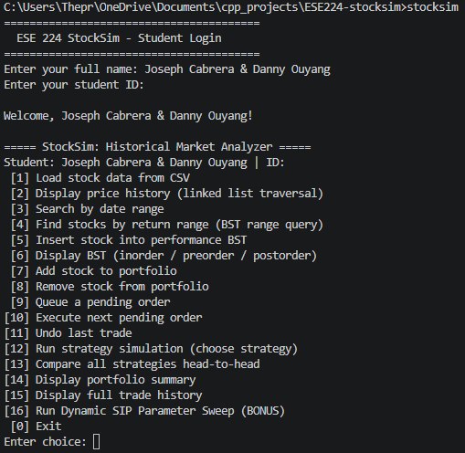
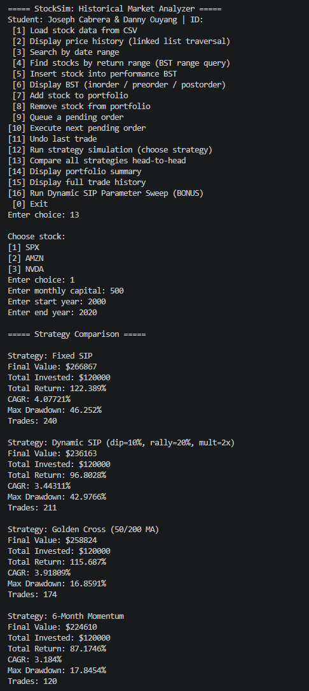

# StockSim

A C++ command-line program that loads historical daily stock prices and backtests investment strategies against them. Built by Joseph Cabrera and Danny Ouyang as the final project for ESE 224 at Stony Brook University, Spring 2026.



## Features

- Loads daily price history for SPX, AMZN and NVDA from Yahoo Finance CSV files, filtered to 2000–2020
- Displays and searches price history by date range
- Ranks stocks by return in a binary search tree, with range queries and inorder, preorder and postorder traversals
- Runs a portfolio starting from $10,000 cash: add and remove positions, queue orders, execute them, and undo the last trade
- Backtests four strategies, one at a time or head to head
- Bonus: sweeps the Dynamic SIP parameters to find the best-performing combination

## Strategies

| Strategy | Rule |
|---|---|
| Fixed SIP | Invests a fixed amount on the first trading day of each month (the baseline) |
| Dynamic SIP | Invests more after a dip from the 12-month high and less after a rally from the 12-month low |
| Golden Cross | Buys when the 50-day moving average crosses above the 200-day, and sells when it crosses back below |
| Momentum | Each month, invests if the 6-month trailing return clears a threshold, and moves to cash if it turns negative |

The bonus sweep's best Dynamic SIP settings were a 14.2% dip trigger, 5.5% rally trigger and 3x multiplier on SPX from 2000 to 2020. [`bonus_strategy.txt`](bonus_strategy.txt) describes them in full.



## Data structures

Each part of the program is built on a structure implemented from scratch:

| Structure | Class | Used for |
|---|---|---|
| Doubly linked list with forward and reverse iterators | `PriceHistory` | Daily prices in date order; the reverse iterator drives the Momentum lookback |
| Binary search tree | `StockBST` | Ranking stocks by return, and storing sweep results by final portfolio value |
| Circular queue | `CircularQueue` | The 50- and 200-day moving-average windows |
| Linked-list queue | `OrderQueue` | Pending orders, first in, first out |
| Linked-list stack | `TradeStack` | Trade history and undo |

The class design uses inheritance and polymorphism: `Stock` and `ETF` derive from the abstract `FinancialAsset`, the four strategies derive from the abstract `TradingStrategy`, and a `StockManager` template manages either kind of asset.

## Building and running

```bash
g++ -std=c++11 -Iinclude src/*.cpp main.cpp -o stocksim
./stocksim
```

Or with CMake:

```bash
cmake -B build
cmake --build build
./build/stocksim
```

Run it from the repository root so it can find the CSV files in `data/`.

## Repository contents

| Path | Contents |
|---|---|
| `main.cpp`, `src/`, `include/` | Source code |
| `data/` | Yahoo Finance daily history for SPX, AMZN and NVDA |
| `output/` | Screenshots of the program running |
| [`report/Report.pdf`](report/Report.pdf) | Final project report |
| [`bonus_strategy.txt`](bonus_strategy.txt) | Parameters and description of the bonus strategy |
| [`PROMPTS.md`](PROMPTS.md) | The AI prompt log the course required |
